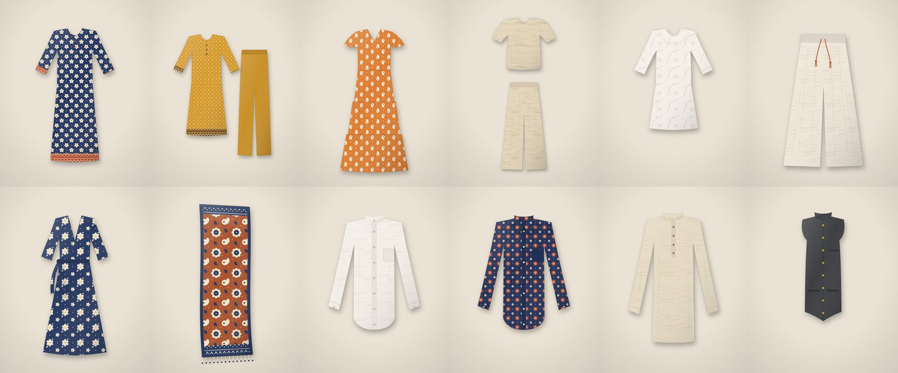

# Kora Threads: a Shopify theme for a small Indian clothing label

A custom Shopify theme for an Instagram or WhatsApp clothing seller, built on Dawn. It adds WhatsApp ordering, a size-guide pop-up, a shoppable lookbook and fabric details driven by metafields.

> **This is a portfolio demo.** Kora Threads is a made-up brand. The products, prices, offers and craft details are placeholders, and no orders are fulfilled. The theme code is real and works on any Shopify store.

**Live store:** coming soon. The development store isn't set up yet, so this README has no store screenshots. I'll add them once it's running rather than post mock-ups.

The 12 demo products ship with artwork drawn by the scripts in [`tools/`](tools). There are no stock photos, and every colour option has its own matching picture:



## What I built

Everything below is my own work on top of Dawn. The history makes the split easy to see: the first commit, `Dawn base (upstream)`, is Dawn 16.1.1 untouched, and each commit after it is one piece of the customisation.

**Homepage**
- **Hero banner** ([`sections/kora-hero.liquid`](sections/kora-hero.liquid)). Split layout with a small label, heading, two buttons and a row of highlights (COD, exchanges, shipping). If no image is chosen it uses a built-in illustration, so a fresh install never shows a grey box.
- **Featured collection**: Dawn's section, set up for a `new-arrivals` collection with portrait cards, a hover image and quick add.
- **Why shop with us** ([`sections/kora-why-us.liquid`](sections/kora-why-us.liquid)). Icon + title + text blocks with icons for cotton, block printing, cash on delivery, exchanges and WhatsApp. Two columns on phones, four on desktop.
- **Shop the look**, built from scratch ([`sections/kora-shop-the-look.liquid`](sections/kora-shop-the-look.liquid), [`assets/kora-shop-the-look.js`](assets/kora-shop-the-look.js)). A styled image with numbered hotspots next to a numbered product list and the total price of the outfit. Tapping a hotspot highlights its product (and scrolls to it on phones). Hovering a product lights up its hotspot. Merchants can move each hotspot from the theme editor.

**Product page** (three new blocks for Dawn's product section, already placed in `templates/product.json`)
- **Size guide pop-up** ([`snippets/kora-size-guide.liquid`](snippets/kora-size-guide.liquid)). Opens a native `<dialog>`: a centred pop-up on desktop, a bottom sheet on phones. It has an inches/cm switch that remembers your choice, and it greys out sizes the style isn't made in. A "between sizes?" link opens WhatsApp. The chart is picked per product from a metafield.
- **Order on WhatsApp** ([`snippets/kora-whatsapp-order.liquid`](snippets/kora-whatsapp-order.liquid)). A `wa.me` link with the product name, selected size and colour, price and link already typed into the message. It stays in sync when the shopper changes variant, using Dawn's own `variantChange` event.
- **Fabric and care** ([`snippets/kora-fabric-care.liquid`](snippets/kora-fabric-care.liquid)). Reads `custom.fabric`, `custom.craft` and `custom.care` metafields and hides any row that's empty.
- **Floating WhatsApp chat button** on every page ([`snippets/kora-whatsapp-float.liquid`](snippets/kora-whatsapp-float.liquid)), shown once a number is set.

**Brand and SEO**
- Colour schemes based on unbleached cotton, indigo, madder red and turmeric. Fraunces for headings, DM Sans for body text, and a small block-print motif used as a border and in labels ([`assets/kora-theme.css`](assets/kora-theme.css)).
- Breadcrumb structured data on product and collection pages ([`snippets/kora-structured-data.liquid`](snippets/kora-structured-data.liquid)).
- A fallback share image, so links pasted into WhatsApp or Instagram always get a preview picture.
- A high-priority hero image and light theme images (about 270 KB each) for a quick first screen on phones.
- New theme settings under **Theme settings → Kora Threads** for the WhatsApp number and message.

**Demo data**
- [`demo-data/products.csv`](demo-data/products.csv) has 12 products and 118 variants (Colour × Size), with SKUs, stock levels (a few sizes sold out on purpose), variant images, SEO titles and descriptions, and metafield values. It uses the column names from Shopify's current import template.
- [`tools/`](tools) contains the scripts that draw the product art and build the CSV from one catalogue file, so the pictures always match the colour options.

## What Dawn provides

Everything not listed above is Dawn: header and menus, cart drawer, collection pages with filtering and sorting, search, the product media gallery and variant picker, quick add, customer accounts, accessibility basics, and the Organization, WebSite and Product structured data. I changed a few Dawn files only where my features plug in: the product section (new blocks), the layout (two includes), the share-image fallback in `snippets/meta-tags.liquid`, and the settings and templates.

## Hosting, speed and security

Shopify hosts the store, so there's no server or database to look after. Shopify handles HTTPS, scaling during traffic spikes and the PCI-compliant checkout. Pages are rendered on Shopify's servers from Liquid, so search engines and slow phones get complete HTML straight away. On top of Dawn, the theme adds about 6 KB of JavaScript (deferred, no libraries, no build step) and lazy-loads everything below the first screen.

## Set it up on a store

You need a Shopify Partner account and a development store. Both are free to create; check Shopify's current Partner terms when you sign up.

1. **Create the store.** Sign up at [partners.shopify.com](https://partners.shopify.com), then go to **Stores → Add store → Development store**. In the store admin, set **Settings → General** to store name *Kora Threads* and currency *Indian Rupee (INR)*.
2. **Add the metafield definitions** under **Settings → Custom data → Products → Add definition**. Do this before importing, or the metafield columns are skipped.

   | Name | Namespace and key | Type |
   |---|---|---|
   | Fabric | `custom.fabric` | Single line text |
   | Craft | `custom.craft` | Single line text |
   | Care instructions | `custom.care` | Multi-line text |
   | Size chart | `custom.size_chart` | Single line text (values: `women-tops`, `women-bottoms`, `men-tops`) |

3. **Import the products.** Go to **Products → Import** and upload [`demo-data/products.csv`](demo-data/products.csv). Shopify downloads the images from this repo during the import. If any images are missing afterwards, upload them by hand from [`demo-data/images`](demo-data/images).
4. **Create the collections** under **Products → Collections → Create collection**, as *automated* collections. The handles must match, because the homepage points at them.

   | Title | Condition | Handle |
   |---|---|---|
   | New arrivals | Tag is equal to `new-arrivals` | `new-arrivals` |
   | Women | Tag is equal to `women` | `women` |
   | Men | Tag is equal to `men` | `men` |
   | Co-ords and sets | Tag is equal to `sets` | `co-ords-and-sets` |

5. **Push the theme** with [Shopify CLI](https://shopify.dev/docs/storefronts/themes/tools/cli). Install it once with `npm install -g @shopify/cli@latest`, or put `npx @shopify/cli@latest` in place of `shopify` in the commands below. Replace `your-store` with your development store's address (it's in the admin's web address, or under **Settings → Domains**), and run the push from inside the theme folder:

   ```bash
   git clone https://github.com/bhargavang/kora-threads-theme.git
   cd kora-threads-theme
   shopify theme push --store your-store.myshopify.com --unpublished
   ```

   The CLI opens a browser window for you to log in to Shopify the first time. Then go to **Online Store → Themes** and publish *Kora Threads*. To preview while editing, use `shopify theme dev --store your-store.myshopify.com` instead.
6. **Set the WhatsApp number** in **Theme settings → Kora Threads** (digits only, with country code, for example `919876543210`). Without a number, the product page button still works: WhatsApp opens with the message filled in and the shopper picks who to send it to.
7. **Optional extras for a fuller demo:**
   - Filters: add Size, Colour, Price and Product type in the **Search & Discovery** app.
   - Menus: Shop all, Women, Men, New arrivals in the main menu.
   - A discount code under **Discounts**.
   - Order and shipping emails under **Settings → Notifications**.

Development stores are password-protected. To share the demo, give people the storefront password from **Online Store → Preferences**.

## Checks

```bash
npx @shopify/cli theme check
```

This reports 0 errors. The 9 warnings all come from Dawn's own files, and stock Dawn 16.1.1 gives the same 9. A GitHub Action runs the same check on every push.

## Rebuild the demo images and CSV

You only need this if you change the catalogue in [`tools/catalogue.py`](tools/catalogue.py). It needs Python 3 with no extra packages, Node 18+ and Google Chrome.

```bash
cd tools
npm install
python3 build_images.py && node render_images.mjs
python3 build_csv.py
```

## Credits and licence

Built on [Dawn](https://github.com/Shopify/dawn) by Shopify, version 16.1.1. Dawn's licence is in [`LICENSE.md`](LICENSE.md). It's MIT-style, with Shopify's condition that the code is used for themes that work with Shopify. My additions are shared under the same terms. Headings use Fraunces and body text uses DM Sans, both served from Shopify's font library. The product art is drawn by code in this repo.

Built by [Bhargav Angadi](https://bhargavang.github.io/bhargavang/), a freelance web developer in Bengaluru. If you sell clothes on Instagram or WhatsApp and want a store like this, get in touch.
